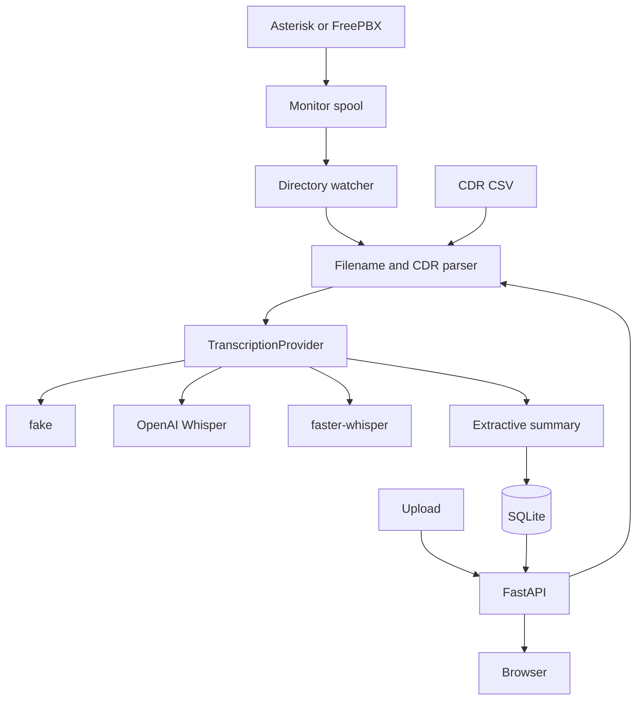

# SIP Call Recorder & Transcript

[](https://github.com/maikama8/sip-call-recorder-transcript/actions/workflows/ci.yml)

A recorded call is only useful if you can find it later. This service watches an Asterisk or FreePBX monitor directory, or accepts an uploaded WAV or MP3, reads the caller, callee, uniqueid, and timestamps from the filename and the CDR, and stores a speaker-labelled transcript you can search.

It is a portfolio project: a small FastAPI application with a provider boundary around transcription. The default provider runs entirely offline, so the API, the tests, the CLI, and Docker start with no API keys. OpenAI Whisper and a local faster-whisper model are wired in behind the same interface and selected with an environment variable.

## Features

- `POST /calls` stores an uploaded recording (wav, mp3, gsm, ogg, flac, ulaw, alaw) or a `.txt` transcript.
- A directory watcher copies closed files out of an Asterisk or FreePBX monitor spool, including the `YYYY/MM/DD/` layout.
- Filenames from FreePBX `sub-record-check` and from the dialplan in `examples/extensions_custom.conf` yield caller, callee, uniqueid, and start time. A bare `{uniqueid}.wav` is filled from the CDR.
- Asterisk `cdr_csv` (`Master.csv`) and a FreePBX `asteriskcdrdb.cdr` export join on uniqueid or `recordingfile`.
- Transcripts are speaker-labelled segments. Keyword search covers the transcript, the summary, the parties, and the uniqueid.
- A short extractive summary names the parties and keeps the first two sentences that carry the point of the call.
- SQLite via SQLAlchemy. `GET /calls`, `GET /calls/{id}`, `GET /calls/{id}/transcript`, `GET /calls/{id}/audio`, `GET /search`.
- A browser UI at `/ui` lists calls, plays the audio, and seeks when you click a transcript line.
- Interactive OpenAPI docs at `/docs` and a `/health` probe.

The offline provider does not decode audio. For a WAV or MP3 it returns a bundled sample call, and the call's `notice` says so. Text uploads are split on `caller:` / `callee:` / `agent:` / `customer:` lines. OpenAI Whisper and faster-whisper return real text with `speaker` set to `unknown`, because neither one diarizes.

## Tech stack

- Python 3.11+
- [FastAPI](https://fastapi.tiangolo.com/) and [Pydantic Settings](https://docs.pydantic.dev/latest/concepts/pydantic_settings/)
- [SQLAlchemy](https://www.sqlalchemy.org/) 2.0 and SQLite
- [Uvicorn](https://www.uvicorn.org/)
- [HTTPX](https://www.python-httpx.org/) for the OpenAI REST calls
- [pytest](https://docs.pytest.org/) and [Ruff](https://docs.astral.sh/ruff/)
- Docker

`faster-whisper` is an optional install. It is not part of the base image or the default `requirements.txt`, because it downloads a speech model.

## Architecture



`app/main.py` builds one transcription provider from the environment when the process starts. The database opens in the application lifespan, and the watcher thread starts only when `WATCH_ENABLED` is set and `MONITOR_DIR` is not empty. Routes talk to a `CallArchive`, so tests can replace the provider without touching the network.

| `TRANSCRIPTION_PROVIDER` | Behavior |
| --- | --- |
| `fake` (default) | Text files are split into speaker segments. Audio files receive the bundled sample call, with a `notice` saying the audio was not decoded. |
| `openai` | Multipart request to `{OPENAI_BASE_URL}/audio/transcriptions` using `OPENAI_TRANSCRIPTION_MODEL` (default `whisper-1`) and `verbose_json`. Segments are labelled `unknown`. Requires `OPENAI_API_KEY`. |
| `faster_whisper` | Loads `faster-whisper` and transcribes on this machine. Segments are labelled `unknown`. Requires `pip install faster-whisper`. |

Choosing `openai` without a key, or `faster_whisper` without the package installed, stops the process at startup with a clear error.

Metadata precedence, highest first:

1. Fields on `POST /calls` (`caller`, `callee`, `uniqueid`, `direction`, `started_at`, …).
2. The CDR row, for parties, caller name, times, disposition, and talk time (`billsec`).
3. The filename, for anything still empty. Direction stays with the filename when it carries a FreePBX call type (`internal`, `out`, `in`, …). The CDR context is only a fallback (`from-internal`, `from-trunk`, …).

Timestamps are the PBX clock, stored with no timezone. `created_at` is UTC.

## Getting started

### Local

```bash
git clone https://github.com/maikama8/sip-call-recorder-transcript.git
cd sip-call-recorder-transcript
python -m venv .venv
source .venv/bin/activate  # Windows: .venv\Scripts\activate
pip install -r requirements.txt
cp .env.example .env
uvicorn app.main:app --reload --host 127.0.0.1 --port 8000
```

- API: `http://127.0.0.1:8000`
- Docs: `http://127.0.0.1:8000/docs`
- Health: `http://127.0.0.1:8000/health`
- Browser UI: `http://127.0.0.1:8000/ui`

Install `requirements-dev.txt` instead when you also want pytest and Ruff. `make dev`, `make test`, and `make run` wrap the same commands.

The CLI uses the same database as the API:

```bash
python -m app.cli ingest recording.wav
python -m app.cli search "invoice 1842"
python -m app.cli calls
python -m app.cli watch-once
```

### Docker

```bash
docker compose up --build
```

The image listens on port 8000 and defaults to the fake provider. SQLite and the copied recordings live in the `call-data` volume at `/data`. Compose sets `WATCH_ENABLED=true` and points `MONITOR_DIR` at a named volume, so the container starts with an empty spool. An empty `.env` copied from `.env.example` is enough for the variables compose interpolates.

On a PBX host, replace the named monitor volume with the real spool, read-only:

```yaml
volumes:
  - /var/spool/asterisk/monitor:/var/spool/asterisk/monitor:ro
```

FreePBX writes `YYYY/MM/DD/` under that directory. The watcher is recursive. Details, including the CDR export from `asteriskcdrdb`, are in [docs/freepbx.md](docs/freepbx.md).

Run a single worker. The watcher and SQLite are owned by this process.

## Asterisk integration

Two filename shapes are recognized. Both are listed, line for line, in [`examples/filenames.txt`](examples/filenames.txt).

FreePBX `sub-record-check` (type, destination, source, date, time, uniqueid):

```text
internal-102-100-20250116-102939-1737016179.6.wav
```

That is an internal call to extension 102 from extension 100. `out-…` is outbound, `in-…` and `external-…` are inbound, `rg-…` is a ring group, `q-…` is a queue.

The dialplan shipped with this repo names the parties in order. It filters caller id with `FILTER()` before the value touches the filename, records only the bridged audio (`b`), and beeps every 15 seconds (`B(15)`):

```text
20261102-143015-1730554215.23-1001-200.wav
```

The context is [`examples/extensions_custom.conf`](examples/extensions_custom.conf). The option-by-option notes, `cdr_csv`, and the `^{MIXMONITOR_FILENAME}` command form are in [docs/asterisk-mixmonitor.md](docs/asterisk-mixmonitor.md). FreePBX recording policy, `MIXMON_DIR`, and the MariaDB export are in [docs/freepbx.md](docs/freepbx.md).

A file named only with the uniqueid is completed from the CDR:

```text
1730554215.23.wav
```

[`examples/sample_cdr.csv`](examples/sample_cdr.csv) is one answered Asterisk row for that id. [`examples/freepbx_cdr.csv`](examples/freepbx_cdr.csv) is the same idea with `calldate` and `recordingfile`.

## Configuration

Settings are loaded from the environment and from a `.env` file in the working directory. Names are case-insensitive. See `.env.example` for the full list.

| Variable | Default | Purpose |
| --- | --- | --- |
| `TRANSCRIPTION_PROVIDER` | `fake` | `fake`, `openai`, or `faster_whisper` |
| `OPENAI_API_KEY` | empty | Required when the provider is `openai` |
| `OPENAI_BASE_URL` | `https://api.openai.com/v1` | API root, including compatible gateways |
| `OPENAI_TRANSCRIPTION_MODEL` | `whisper-1` | Audio model |
| `OPENAI_TIMEOUT_SECONDS` | `60` | HTTP timeout |
| `FASTER_WHISPER_MODEL` | `base` | Model size passed to faster-whisper |
| `FASTER_WHISPER_DEVICE` | `cpu` | `cpu` or `cuda` |
| `FASTER_WHISPER_COMPUTE_TYPE` | `int8` | CTranslate2 compute type |
| `DATABASE_URL` | `sqlite:///./data/calls.db` | SQLAlchemy URL. Compose uses `sqlite:////data/calls.db` |
| `RECORDINGS_DIR` | `./data/recordings` | Copies of ingested audio |
| `MONITOR_DIR` | empty | Spool to watch. Empty disables the watcher even if `WATCH_ENABLED` is true |
| `CDR_PATH` | empty | `Master.csv` or a FreePBX CSV export. Reread when the mtime changes |
| `WATCH_ENABLED` | `false` | Start the spool thread. Compose turns this on |
| `WATCH_INTERVAL_SECONDS` | `5` | Pause between scans |
| `WATCH_SETTLE_SECONDS` | `5` | A file is ready when its mtime is at least this old. `0` ingests immediately |
| `MAX_UPLOAD_BYTES` | `26214400` | Upload limit, 25 MiB. Also applied to spool files |
| `DEFAULT_LANGUAGE` | `en` | Language hint when the request does not pass one |

Local transcription:

```bash
pip install faster-whisper
# in .env
# TRANSCRIPTION_PROVIDER=faster_whisper
```

## API

### `GET /health`

```bash
curl -s http://127.0.0.1:8000/health
```

```json
{
  "status": "ok",
  "transcription_provider": "fake",
  "watcher": "disabled",
  "calls": 0
}
```

`GET /` returns the same fields plus the service version and links to `/docs` and `/ui`. `watcher` is `disabled`, `running`, or `stopped`.

### `POST /calls`

Multipart form. `file` is required. `caller`, `callee`, `caller_name`, `uniqueid`, `direction`, `started_at`, and `language` are optional and override the filename and the CDR.

```bash
curl -s -X POST http://127.0.0.1:8000/calls \
  -F "file=@recording.wav;filename=20261102-143015-1730554215.23-1001-200.wav"
```

With the fake provider the stable part of the response is:

```json
{
  "caller": "1001",
  "callee": "200",
  "uniqueid": "1730554215.23",
  "started_at": "2026-11-02T14:30:15",
  "direction": null,
  "provider": "fake",
  "source": "upload",
  "playable": true,
  "summary": "Recorded call from 1001 to 200. I am calling about invoice 1842. Invoice 1842 is still unpaid.",
  "segments": [
    {
      "speaker": "caller",
      "start": 0.0,
      "end": 4.0,
      "text": "Good afternoon, this is Ada from billing. I am calling about invoice 1842."
    },
    {
      "speaker": "callee",
      "start": 4.0,
      "end": 8.0,
      "text": "Hello Ada, this is the support desk. Invoice 1842 is still unpaid."
    }
  ]
}
```

`id` and `audio_url` are generated. Two further segments follow (the transfer, then ticket 5521). Segment times on the fake provider are synthetic, four seconds per line, so the UI has something to seek. The `notice` says the audio was not decoded.

A `.txt` upload is stored as the transcript itself and `playable` is false. `agent:` is the callee, `customer:` is the caller. A line that merely contains a colon stays `unknown`.

### `POST /cdr`

Replaces the file at `CDR_PATH` and reloads it. The body is `{ "rows": <uniqueids> }`. The route returns 400 when `CDR_PATH` is empty.

### `GET /calls`

Filters: `caller`, `callee`, `uniqueid` (exact), `direction`, `q`, `limit` (1–200, default 50), `offset`. Newest `started_at` first. `direction=out` matches the stored value `outbound`.

### `GET /calls/{id}` and `GET /calls/{id}/transcript`

The call detail includes the segments. The transcript route returns `text`, `summary`, `segments`, `provider`, and `notice`.

### `GET /calls/{id}/audio`

The stored bytes, inline, with a range request so the browser can seek. The path must stay inside `RECORDINGS_DIR`.

### `DELETE /calls/{id}`

Deletes the row, the segments, and the copied audio. Returns 204.

### `GET /search?q=invoice`

Case-insensitive substring match across the transcript, summary, caller, callee, caller name, uniqueid, and filename. `%` and `_` are matched literally. Each hit includes a `snippet`.

```bash
curl -s "http://127.0.0.1:8000/search?q=invoice%201842"
```

### Errors

| Status | When |
| --- | --- |
| 400 | Empty upload, a `started_at` that is not an ISO timestamp, or a `language` longer than 16 characters |
| 404 | Unknown call id, or the audio file is gone |
| 409 | The watcher sees a spool path that was already ingested |
| 413 | Upload larger than `MAX_UPLOAD_BYTES` |
| 415 | Extension is not audio or `.txt` |
| 422 | Query parameters fail validation |
| 502 | The selected provider failed while calling a model or API |
| 503 | The selected provider is missing a key or dependency at request time |

A provider failure does not leave a partial call. The copied audio is removed. The watcher retries a spool file twice more, then leaves it until the process restarts.

## Project structure

```
sip-call-recorder-transcript/
├── app/
│   ├── main.py                         # application factory and lifespan
│   ├── cli.py                          # ingest, search, list, watch-once
│   ├── config.py                       # pydantic-settings
│   ├── runtime.py                      # database, archive, watcher
│   ├── api/                            # routes, dependencies, error handlers
│   ├── db/                             # SQLAlchemy models and queries
│   ├── schemas/call.py                 # response models
│   ├── samples/sample_call.txt         # bundled call used for fake audio
│   ├── static/index.html               # browser UI
│   └── services/
│       ├── metadata.py                 # MixMonitor filenames and CDR CSV
│       ├── speakers.py                 # caller / callee lines
│       ├── summary.py                  # extractive summary
│       ├── archive.py                  # ingest and search
│       ├── watcher.py                  # monitor directory scan
│       └── transcription/              # fake, OpenAI, faster-whisper
├── docs/
│   ├── asterisk-mixmonitor.md
│   └── freepbx.md
├── examples/
│   ├── extensions_custom.conf
│   ├── filenames.txt
│   ├── sample_cdr.csv
│   └── freepbx_cdr.csv
├── tests/
├── Dockerfile
├── docker-compose.yml
├── Makefile
├── requirements.txt
├── requirements-dev.txt
├── pyproject.toml
└── .env.example
```

## Testing

```bash
pip install -r requirements-dev.txt
ruff check .
ruff format --check .
pytest
```

GitHub Actions (`.github/workflows/ci.yml`) runs those three commands on Python 3.12 for pushes to `main` and for pull requests.

The suite covers filename and CDR parsing (including FreePBX's destination-then-source order, `systemname` uniqueids, and `calldate`), the monitor watcher (settle window, dated directories, CDR join, a file that fails three times), the HTTP API with the fake provider, provider selection, and the OpenAI adapter with a stand-in HTTP client. No test calls the network or downloads a speech model.

## Roadmap

- Join MixMonitor `r()` and `t()` files so a speaker is the received or transmitted leg, not a label on a sample transcript.
- An AMI listener (`Newchannel`, `BridgeEnter`, `Hangup`, `MixMonitorMute`) so a call can be tracked before the file hits the spool.
- Read FreePBX CDR from `asteriskcdrdb` directly, instead of a CSV export.
- A summary provider with the same shape as transcription, including an OpenAI chat model.
- A webhook when a transcript is stored.
- Retention: delete audio older than N days, and a legal hold flag.
- SRT and VTT export of the segments.
- PostgreSQL for a multi-process deploy. The archive talks to SQLAlchemy, not to SQLite calls.

## Privacy and consent

Recording a telephone call is regulated. Some places allow one party to consent. Others require every party to know, before the conversation, that it is being recorded. This service does not decide which rule applies, and it does not record anything by itself. It stores files a PBX has already written, or files you upload.

Use a spoken warning, MixMonitor's beep (`B`, and `p` at the start), or both. Keep the recordings on a disk you control. The default provider does not send audio anywhere. `TRANSCRIPTION_PROVIDER=openai` uploads the recording to that API. Do not commit `data/` or a copied spool. `.gitignore` excludes the database and the recordings directory.

## Author

**Abdulrasheed Oseni** ([@maikama8](https://github.com/maikama8)), Zarachtech — VoIP specialist (Asterisk, FreePBX) and full-stack developer.

This repository is a public portfolio project.

## License

[MIT](LICENSE). Copyright (c) 2026 Abdulrasheed Oseni.
